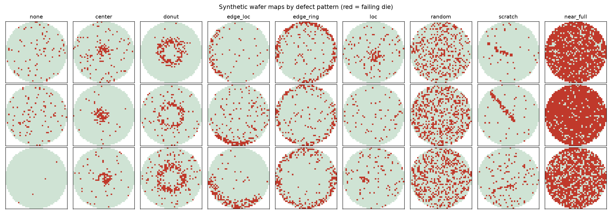
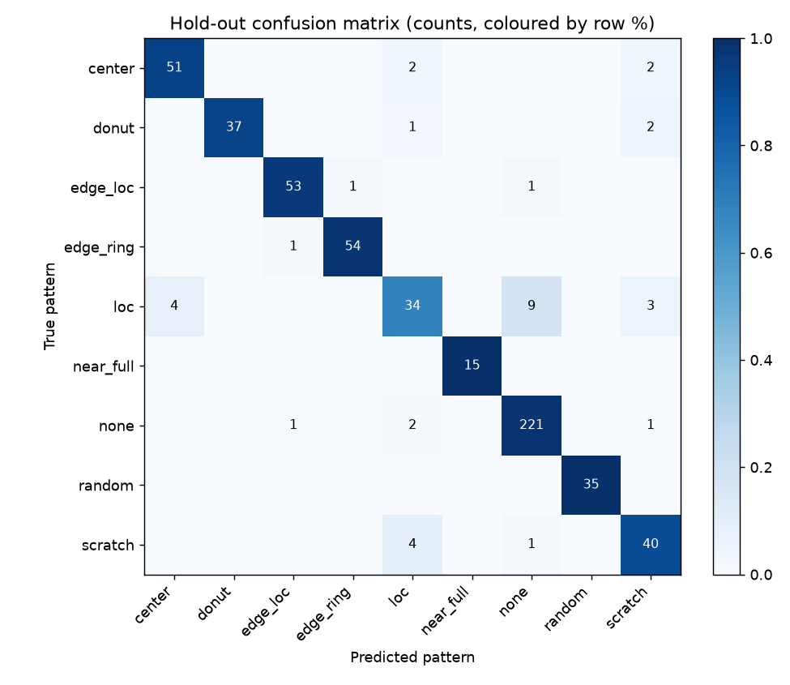
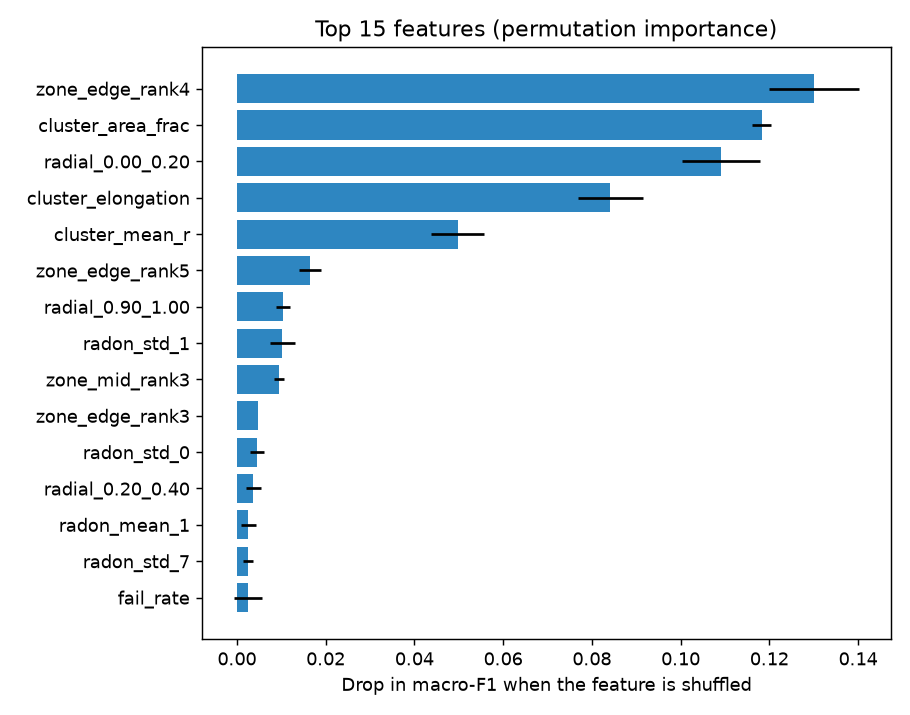
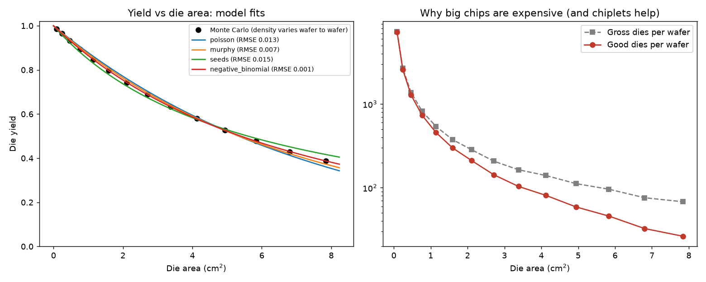
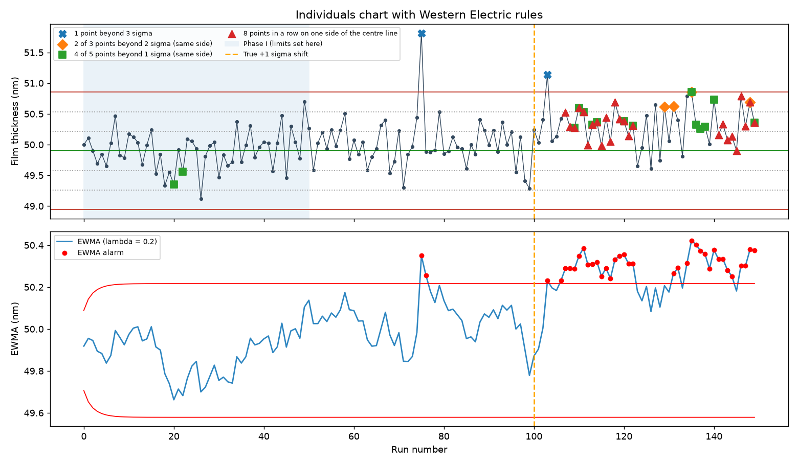

# Wafer Yield Analytics

**Wafer-map defect pattern classification, die-yield modelling and statistical process control for semiconductor manufacturing, in Python.**

A fab tests every die on every wafer. The *pattern* of failing dies tells engineers where to look: an edge ring points at etch or deposition non-uniformity at the wafer edge, a scratch at wafer handling or CMP, a centre blob at gas flow or spin-coat issues. This project builds the three analytics tools a yield/process engineer uses every day:

| Module | Question it answers | Methods |
|---|---|---|
| `generator.py`, `features.py`, `classify.py` | *What kind of failure pattern is on this wafer?* | Synthetic WM-811K-style wafer maps, 66 rotation-invariant features (radial density, zone density, **Radon transform**, cluster geometry), logistic regression vs random forest vs gradient boosting, permutation importance |
| `yield_model.py` | *How many good chips will a wafer give, and why do big chips cost so much?* | Monte Carlo defect simulation, **Poisson / Murphy / Seeds / negative-binomial** yield models, gross-dies-per-wafer |
| `spc.py` | *Has this tool drifted?* | I-MR control charts, **Western Electric rules**, **EWMA**, Cp/Cpk/Pp/Ppk, average-run-length simulation |
| `wm811k.py` | Run the classifier on real fab data | Loader for the public WM-811K dataset (811k real wafer maps) |

> **All data here is simulated.** The wafer maps use the same encoding as the public [WM-811K](https://www.kaggle.com/datasets/qingyi/wm811k-wafer-map) dataset (0 = no die, 1 = pass, 2 = fail), so the same pipeline can be pointed at real data (see below).

## Results

`python -m wafermap` (seed 7, about 2 minutes on a laptop) gives:

### 1. Pattern classification: macro-F1 0.93 on held-out wafers



2,300 wafers across 9 classes, imbalanced like a real fab (39 % `none`, 3 % `near_full`). Wafer size varies from 30 to 56 dies across, and pattern strength and background noise vary too.

| Model (5-fold stratified CV) | Macro-F1 |
|---|---|
| Logistic regression (baseline) | 0.934 |
| Random forest | 0.944 |
| Histogram gradient boosting | **0.948** |

On the 25 % hold-out set the selected model scores **macro-F1 0.933 / accuracy 0.939**. Most of the errors are physically sensible. A faint, small `loc` cluster is hard to tell from random background (`loc` F1 0.73), and short broken scratches look like local clusters.



Permutation importance shows the model relies on the shape of the biggest fail cluster (elongation, area, angular coverage), the edge-zone densities and the Radon projections:



### 2. Yield modelling: the negative binomial model recovers the true defect density

Killer defects are dropped on 200 simulated 300 mm wafers. Each wafer's defect density is drawn from a Gamma distribution (mean D0 = 0.15 cm⁻², shape α = 2), which is Stapper's derivation of the negative-binomial model. A die grid is then laid over each wafer for 14 die sizes.

| Model | Fitted D0 (cm⁻²) | RMSE |
|---|---|---|
| Poisson | 0.130 (biased low) | 0.013 |
| Murphy | 0.138 | 0.008 |
| Seeds | 0.179 | 0.015 |
| **Negative binomial** | **0.150, α = 2.25** | **0.001** |



The right-hand panel shows why die size dominates chip cost. Good dies per wafer fall much faster than gross dies, which is the economic case for chiplets and tiles.

### 3. SPC: why EWMA is the right chart for small shifts

A deposition tool's film thickness is simulated (target 50 nm, σ ≈ 0.35 nm) with a planted metrology spike and a permanent +1σ shift. Limits come from the first 50 runs (Phase I).



One chart is one random draw, so the charts are compared by **average run length (ARL)**: the mean number of points before an alarm, over 2,000 simulated series.

| Shift | Rule 1 only | All Western Electric rules | EWMA (λ = 0.2, L = 3) |
|---|---|---|---|
| 0 (false alarms, higher is better) | 371 | 78 | **554** |
| 0.5 σ | 157 | 27 | 44 |
| 1 σ | 43 | 9.4 | **9.8** |
| 2 σ | 6.3 | 3.4 | 2.9 |

EWMA detects a 1σ shift about 4× faster than rule 1 alone, as fast as all the run rules combined, and with **7× fewer false alarms** than the run rules. The shift also cuts Cpk from 1.39 to 1.09, below the common 1.33 requirement.

## Quick start

```bash
python -m venv .venv
.venv\Scripts\activate          # Windows  (macOS/Linux: source .venv/bin/activate)
pip install -e ".[dev]"
pytest                          # 30 tests, ~40 s
python -m wafermap              # full run -> reports/figures/*.png + reports/metrics.json
python -m wafermap --quick      # small run in ~15 s
```

### Using the real WM-811K data

Download `LSWMD.pkl` (e.g. from Kaggle). Then:

```python
from wafermap.wm811k import load_wm811k
from wafermap.features import extract_features_batch
from wafermap.classify import holdout_evaluation

wafers, labels = load_wm811k("LSWMD.pkl", max_per_class=1500)
result = holdout_evaluation(extract_features_batch(wafers), labels, "random_forest")
print(result.macro_f1)
```

The loader has not been run against the real file in this repo; the features are size-agnostic, so they work on the dataset's variable map sizes.

## Project layout

```
wafermap/
  generator.py    synthetic wafer maps for 9 defect patterns
  features.py     density, Radon and cluster-geometry features
  classify.py     model comparison, hold-out evaluation, permutation importance
  yield_model.py  yield models, defect Monte Carlo, die-grid counting
  spc.py          I-MR limits, Western Electric rules, EWMA, Cpk, ARL
  wm811k.py       loader for the public WM-811K dataset
  pipeline.py     runs everything and writes reports/
tests/            30 pytest tests (physics/statistics sanity checks + end-to-end)
docs/WALKTHROUGH.md   plain-English explanation of every design decision
```

## References

- Wu, Jang & Chen (2015). *Wafer Map Failure Pattern Recognition and Similarity Ranking for Large-Scale Data Sets.* IEEE Trans. Semiconductor Manufacturing 28(1).
- Stapper (1989). *Fact and fiction in yield modeling.* Microelectronics Journal 20(1-2).
- Montgomery. *Introduction to Statistical Quality Control.* Wiley (control charts, EWMA, ARL).

## License

MIT
